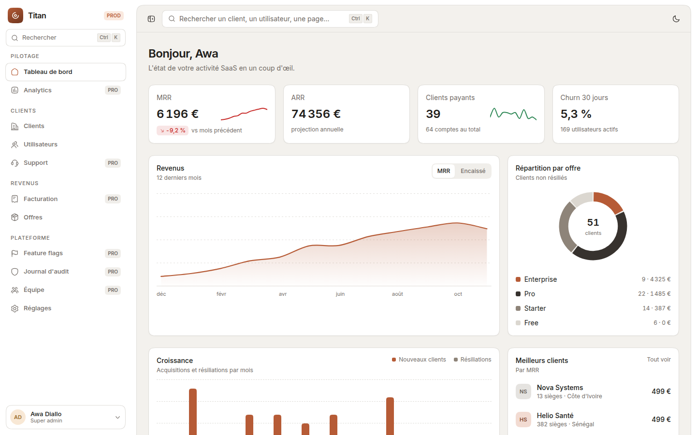
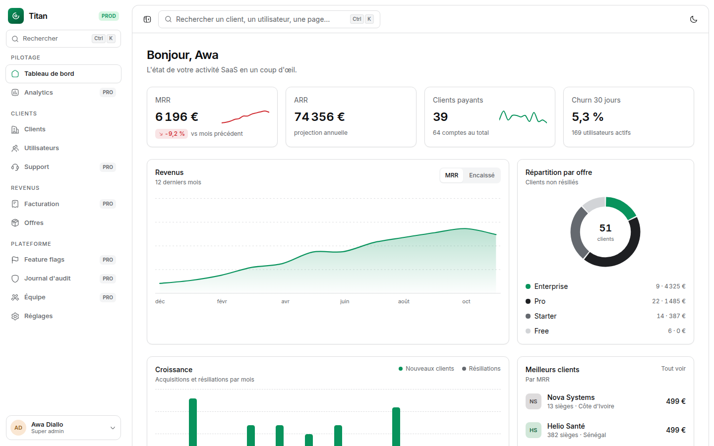
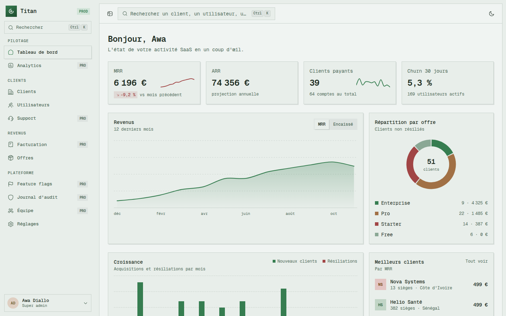
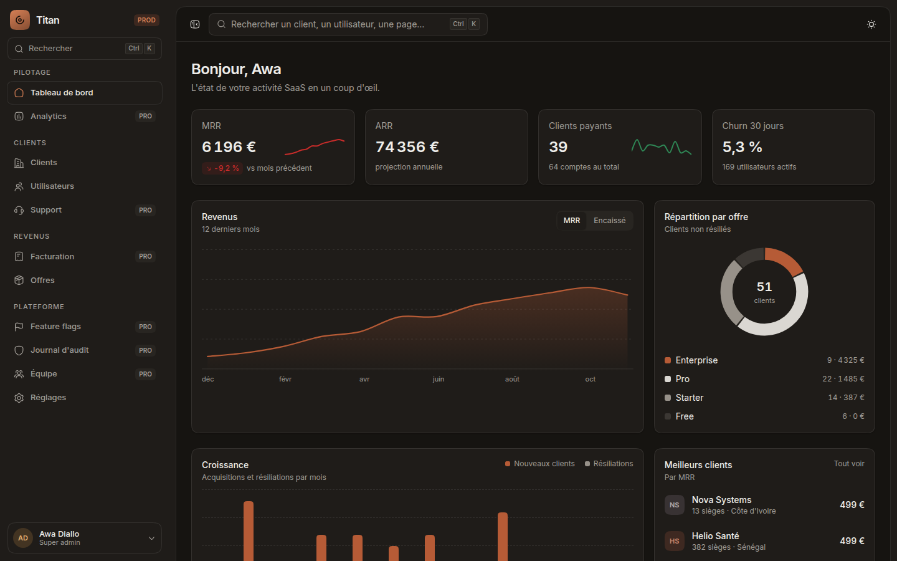
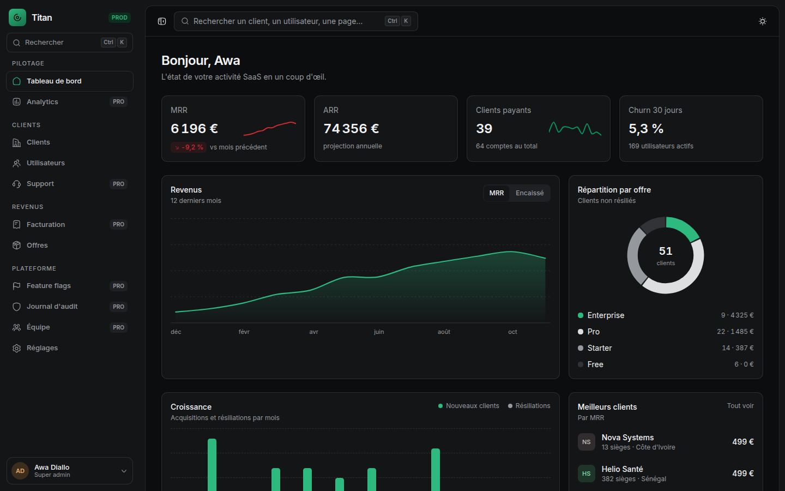
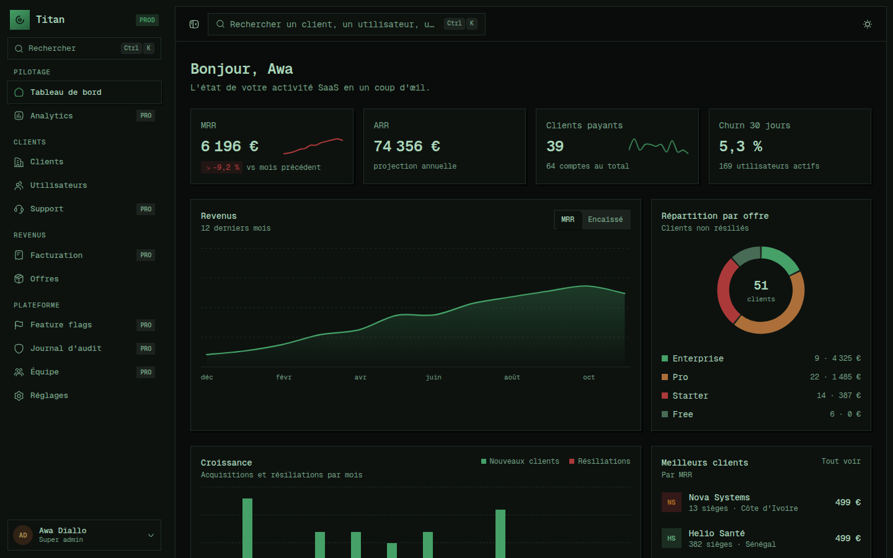
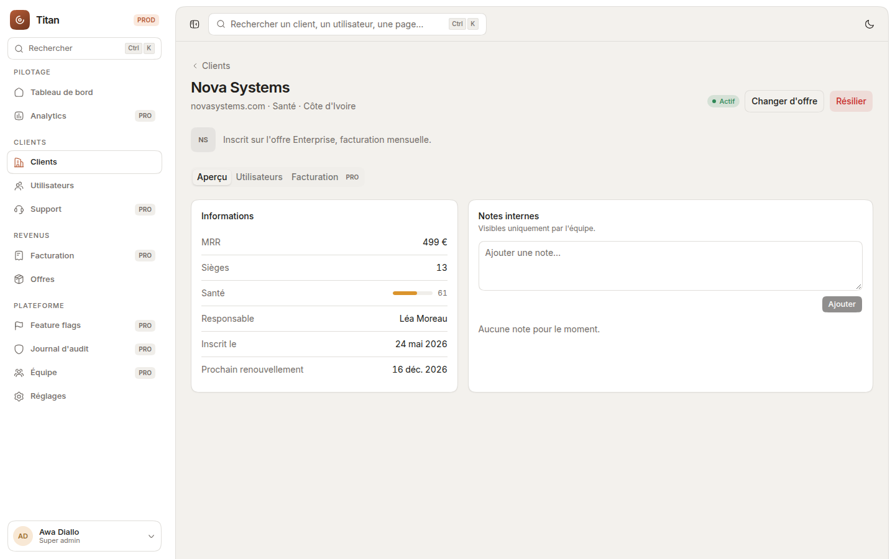
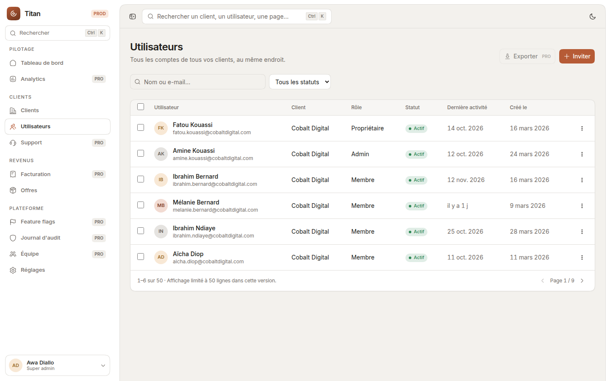

# Titan

**Template de back-office SaaS, par UIForge**

Un dashboard d'administration Next.js pour un produit SaaS : clients, utilisateurs, offres et vue d'ensemble des indicateurs, avec trois thèmes et une couche de données à brancher sur votre API.

[](LICENSE)

## Captures d'écran

| Minimal | Contrast | Terminal |
| --- | --- | --- |
|  |  |  |
|  |  |  |





## Démarrage rapide

```bash
npx degit UiForge-kit/uiforge-titan titan   # ou : git clone https://github.com/UiForge-kit/uiforge-titan.git titan
cd titan && npm install
npm run dev
```

Node.js 20.9 ou plus récent. L'app tourne sur http://localhost:3000. Les textes de l'interface sont en français.

## Free et Pro

Ce dépôt est la version Free. Les modules Pro apparaissent dans la barre latérale avec un badge « Pro » et ouvrent une carte de présentation à la place d'une page. Aucun code Pro n'est livré ici, seulement les points d'entrée.

| Module | Free (ce dépôt) | Pro |
| --- | :---: | :---: |
| Tableau de bord (MRR, ARR, churn, graphiques, alertes) | Oui | |
| Clients et fiche client | Oui | |
| Utilisateurs (invitation, rôle, suspension, suppression) | Oui | |
| Offres | Oui | |
| Réglages et thèmes | Oui | |
| Analytics | | Oui |
| Support (boîte de réception) | | Oui |
| Facturation | | Oui |
| Feature flags | | Oui |
| Journal d'audit (consultation) | | Oui |
| Équipe | | Oui |
| Exports CSV | | Oui |
| Développeurs (clés d'API, webhooks) | | Oui |

Le Free applique aussi quelques plafonds, réglés dans `config/limits.ts` : taille de page, lignes affichées par tableau et fonctionnalités par offre. Le lien d'achat des cartes verrouillées vient de `NEXT_PUBLIC_UPGRADE_URL`. Laissez-le vide : le lien disparaît, la carte reste.

## Fonctionnalités

- Tableau de bord : MRR, ARR, clients payants, churn, courbe de revenus, croissance, répartition par offre, meilleurs clients et points d'attention.
- Clients : liste filtrable et triable, fiche avec offre, résiliation, utilisateurs et notes internes.
- Utilisateurs : invitation, changement de rôle, suspension, suppression, actions groupées.
- Offres : prix, sièges, fonctionnalités, offre mise en avant.
- `DataTable` générique : tri, pagination, sélection, densité.
- Graphiques en SVG/CSS pur, sans dépendance. Les couleurs viennent des tokens du thème.
- Trois thèmes (Minimal, Contrast, Terminal), chacun en clair et sombre, plus réglages de police et de densité.
- Palette de commandes sur `Cmd/Ctrl+K` (pages, clients, utilisateurs), toasts, interface responsive.
- Rôles d'équipe avec contrôle des droits et journal d'audit écrit à chaque action.
- Registre de modules : navigation, réglages, recherche et onglets client lisent `config/modules.ts`.
- `noindex` par défaut, `robots.ts`, `sitemap.ts` et en-têtes de sécurité.

## Stack technique

| | Version |
| --- | --- |
| Next.js (App Router) | 16.3.0 |
| React | 19.2.8 |
| TypeScript | 5.x |
| Tailwind CSS | 4.x |
| shadcn/ui sur Base UI | `@base-ui/react` 1.7+ |
| Zustand | 5.x |
| Hugeicons (gratuit) | `@hugeicons/react` 1.1+ |
| motion | 13.x |

## Structure du projet

```
app/                 Routes. app/(app)/ contient les pages du dashboard, plus robots.ts et sitemap.ts.
components/          UI par domaine (customers, users, plans, dashboard, settings).
  ui/                Primitives shadcn. On les enveloppe plutôt que de les modifier.
  shared/            PageHeader, StatTile, StatusPill, SectionCard, ConfirmDialog, Field.
  data-table/        Tableau générique.
  charts/            Graphiques SVG/CSS.
  pro/               La carte affichée à la place d'une fonctionnalité Pro.
config/              Site, registre des modules, limites, navigation, thèmes, rôles, statuts.
modules/             Un dossier par module Pro. Seulement le point d'entrée dans cette version.
lib/                 Logique pure avec tests à côté : metrics, charts, validation.
  data/              Contrat EntityRepository et son implémentation localStorage.
  mock/              Jeu de données de démo déterministe.
store/               Stores Zustand, actions d'écriture et helpers droits/audit.
hooks/ types/        Hooks partagés et types TypeScript.
```

## Personnaliser

- **Nom et marque** : `config/site.ts` (`name`, `shortName`, `tagline`, `description`). Le logo est dans `components/brand-mark.tsx`. `STORAGE_NAMESPACE` préfixe les clés `localStorage`.
- **Thèmes** : définitions dans `config/themes.ts`, couleurs et rayons dans `app/globals.css` (un bloc `[data-theme="..."]` par thème, plus sa variante `.dark`). Les polices sont dans `config/fonts.ts`.
- **Données de démo** : `lib/mock/seed.ts` génère le jeu de données avec un générateur déterministe. Modifiez-le, puis « Réinitialiser la démo » dans les Réglages pour le recharger.
- **Limites** : `config/limits.ts` (`maxPageSize`, `maxTableRows`, `maxPlanFeatures`).
- **Rôles d'équipe** : `config/staff-roles.ts`.

## Brancher votre backend

Les données passent par `EntityRepository<T>` dans `lib/data/repository.ts` :

```ts
interface EntityRepository<T> {
  load(): Promise<T[] | null>;
  save(items: T[]): Promise<void>;
}
```

1. Implémentez-la contre votre API. `load` doit renvoyer `null`, pas `[]`, quand rien n'existe encore : c'est ce qui déclenche le jeu de démo.
2. Passez-la en troisième argument de `createEntityStore` dans `store/data.ts`.
3. Remplacez `useCurrentStaff` (`hooks/use-staff.ts`), qui incarne un membre de l'équipe pour la démo, par votre session.

Les actions d'écriture sont dans `store/actions.ts`. Chacune vérifie le droit (`guard`), écrit via le store, consigne une entrée d'audit et affiche un toast ; les helpers sont dans `store/action-kit.ts`. Les pages lisent les stores et n'écrivent que via ces actions. Les mises à jour sont optimistes : l'état change d'abord en mémoire, et un `save` en échec est seulement loggé avec `console.error`. Ajoutez votre propre gestion d'erreur et de rollback en branchant une vraie API.

## Variables d'environnement

Copiez `.env.example` vers `.env.local`.

| Variable | Défaut | Rôle |
| --- | --- | --- |
| `NEXT_PUBLIC_SITE_URL` | `http://localhost:3000` | URL publique : canonical, sitemap, robots, `metadataBase`. |
| `NEXT_PUBLIC_ALLOW_INDEXING` | `false` | Mettre `true` pour autoriser l'indexation. |
| `NEXT_PUBLIC_UPGRADE_URL` | vide | Lien affiché sur les cartes Pro verrouillées. Vide = masqué. |

## Scripts

| Script | Rôle |
| --- | --- |
| `npm run dev` | Lance le serveur de développement. |
| `npm run build` | Build de production. |
| `npm run start` | Sert le build de production. |
| `npm run lint` | ESLint. |
| `npm run typecheck` | `next typegen`, puis `tsc --noEmit`. |
| `npm test` | Test runner Node sur `lib/**/*.test.ts` et `modules/**/*.test.ts`. |

## Déploiement

Sur Vercel, ou tout hébergeur qui exécute Next.js :

1. Importez le dépôt.
2. Définissez `NEXT_PUBLIC_SITE_URL` avec votre URL de production.
3. Définissez `NEXT_PUBLIC_ALLOW_INDEXING=true` uniquement si l'app doit être indexée.
4. Si besoin, définissez `NEXT_PUBLIC_UPGRADE_URL`.
5. Déployez. La commande de build par défaut (`next build`) suffit.

## Notes de sécurité

Titan est un template front-end. Ces éléments sont là pour la démo seulement :

- **L'authentification est simulée.** `useCurrentStaff` incarne un membre de l'équipe. Il n'y a pas de connexion.
- **Les données sont dans `localStorage`.** Quiconque a accès au navigateur peut les lire et les modifier.
- **Les droits sont appliqués dans le navigateur.** `guard()` et les contrôles de rôle servent l'UX. Ce n'est pas du contrôle d'accès.
- **La CSP est partielle.** `next.config.ts` définit `object-src`, `base-uri`, `form-action` et `frame-ancestors`, mais pas de `script-src`, car le script anti-flash du thème est inline.

Avant la production : ajoutez une vraie authentification avec sessions, revérifiez chaque droit côté serveur, validez les entrées là aussi, consignez l'audit côté serveur (l'IP des entrées d'audit est un placeholder) et passez à une CSP à nonce. Autres en-têtes déjà en place : `X-Content-Type-Options`, `X-Frame-Options`, `Referrer-Policy`, `Permissions-Policy`, `Strict-Transport-Security`.

## FAQ

**Puis-je l'utiliser dans un projet commercial ?**
Oui. Le code est sous licence MIT. Les éléments tiers gardent leur propre licence, voir `NOTICE`.

**Puis-je retirer la marque UIForge ?**
Oui. La licence MIT demande de conserver la mention de copyright dans les copies du code, pas d'afficher une marque dans votre interface. Changez le nom dans `config/site.ts` et le logo dans `components/brand-mark.tsx`.

**Comment obtenir les modules Pro ?**
Ils ne sont pas dans ce dépôt. Renseignez `NEXT_PUBLIC_UPGRADE_URL` avec votre page d'achat pour que les cartes verrouillées y mènent. Une version Pro remplace les dossiers de `modules/` et `config/limits.ts` ; le registre `config/modules.ts` ne change pas.

**Comment brancher mon API ?**
Implémentez `EntityRepository<T>` et passez-la à `createEntityStore`. Voir « Brancher votre backend ».

**Pourquoi le site est-il en `noindex` ?**
Un back-office n'a pas à apparaître dans les résultats de recherche. L'indexation est opt-in via `NEXT_PUBLIC_ALLOW_INDEXING=true`.

**Pourquoi l'interface est-elle en français ?**
Les textes sont en français, dans les composants et les fichiers `config/`. Il n'y a pas encore de couche i18n.

## Licence

MIT. Voir [LICENSE](LICENSE) et [NOTICE](NOTICE) pour les éléments tiers.

## Support

Ouvrez une issue dans le dépôt.
