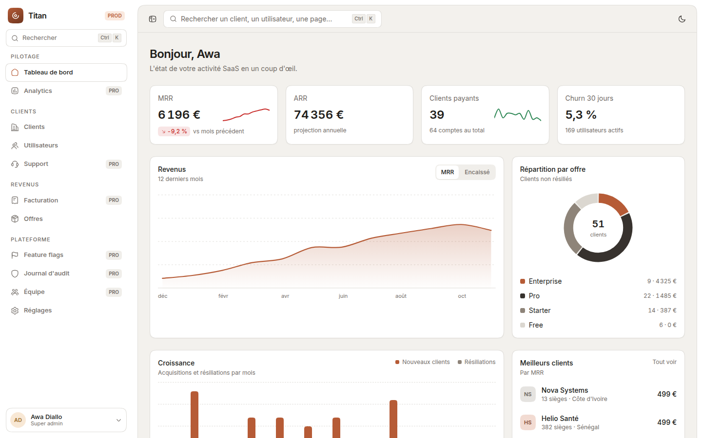
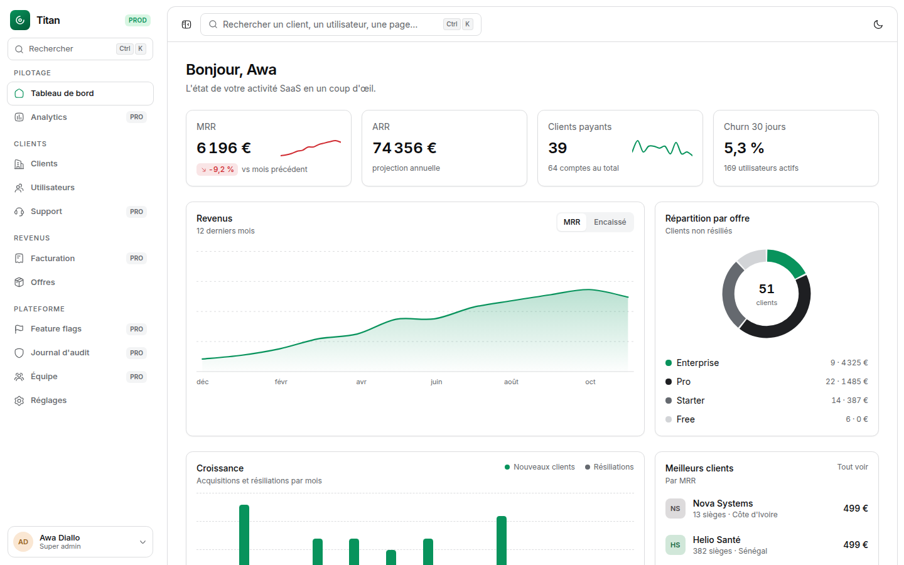
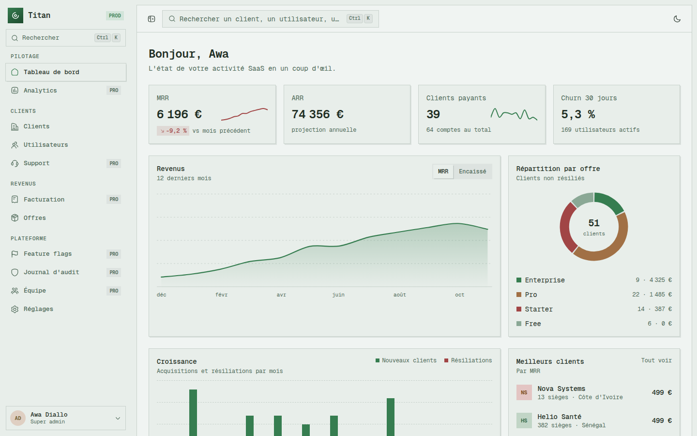
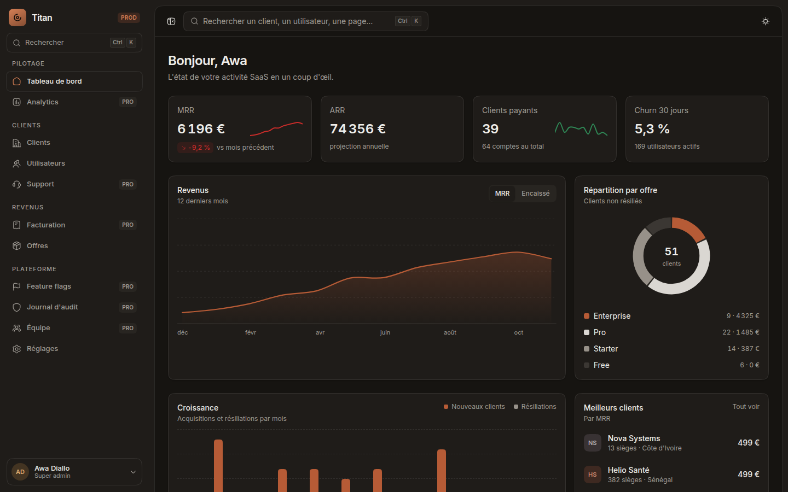
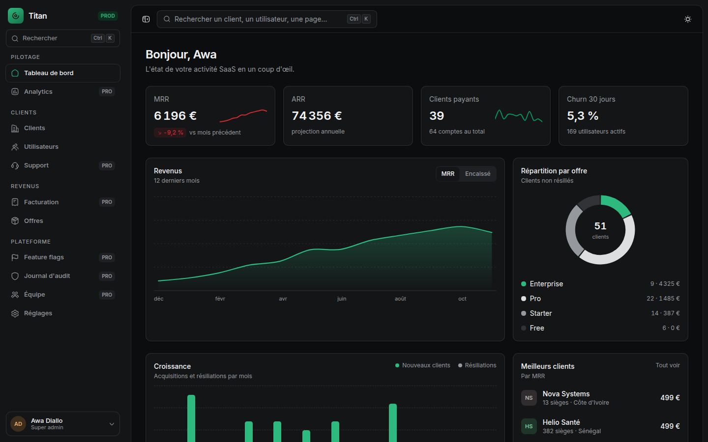
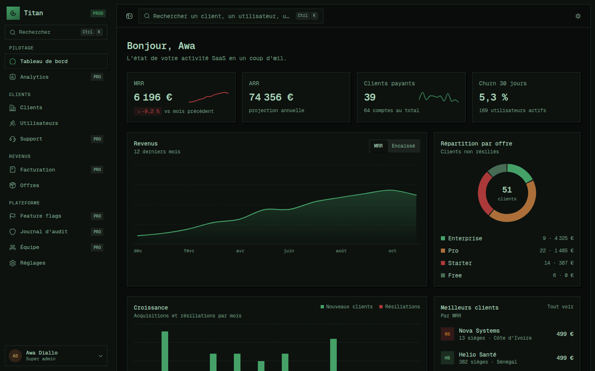
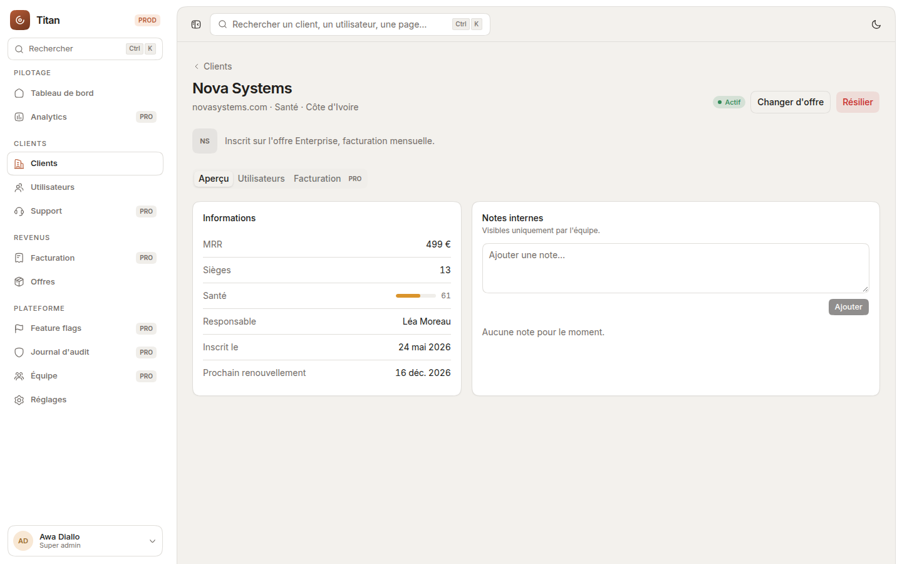
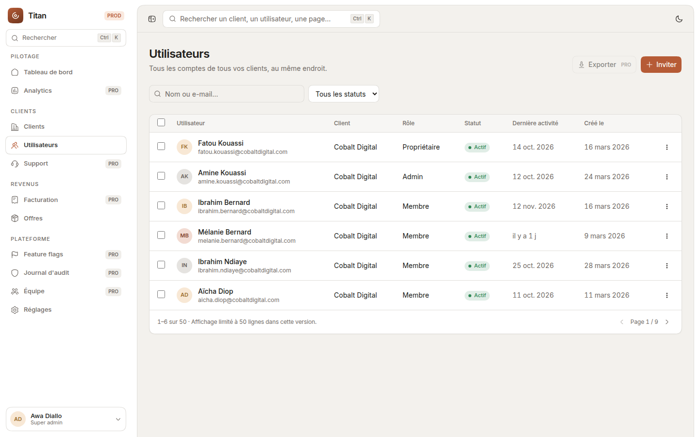

# Titan

**SaaS back-office template, by UIForge**

A Next.js admin dashboard for a SaaS product: customers, users, plans and a metrics overview, with three themes and a data layer you can point at your own API.

[](LICENSE)

## Screenshots

| Minimal | Contrast | Terminal |
| --- | --- | --- |
|  |  |  |
|  |  |  |





## Quick start

```bash
npx degit UiForge-kit/uiforge-titan titan   # or: git clone https://github.com/UiForge-kit/uiforge-titan.git titan
cd titan && npm install
npm run dev
```

Requires Node.js 20.9 or later. The app runs on http://localhost:3000. The interface text is in French.

## Free vs Pro

This repository is the Free version. Pro modules show up in the sidebar with a "Pro" badge and open a presentation card instead of a page. No Pro code ships here, only the entry points.

| Module | Free (this repo) | Pro |
| --- | :---: | :---: |
| Dashboard (MRR, ARR, churn, charts, alerts) | Yes | |
| Customers and customer detail | Yes | |
| Users (invite, role, suspend, delete) | Yes | |
| Plans | Yes | |
| Settings and themes | Yes | |
| Analytics | | Yes |
| Support inbox | | Yes |
| Billing | | Yes |
| Feature flags | | Yes |
| Audit log (viewer) | | Yes |
| Team | | Yes |
| CSV exports | | Yes |
| Developers (API keys, webhooks) | | Yes |

Free also applies a few caps, set in `config/limits.ts`: page size, rows shown per table and features per plan. The purchase link on locked cards comes from `NEXT_PUBLIC_UPGRADE_URL`. Leave it empty and the link disappears, the card stays.

## Features

- Dashboard with MRR, ARR, paying customers, churn, revenue curve, growth, plan breakdown, top customers and items that need attention.
- Customers: filterable and sortable list, detail page with plan, cancellation, users and internal notes.
- Users: invite, change role, suspend, delete, bulk actions.
- Plans: price, seats, features, highlighted plan.
- Generic `DataTable` with sorting, pagination, selection and density.
- Charts in plain SVG/CSS, no chart dependency. Colors come from theme tokens.
- Three themes (Minimal, Contrast, Terminal), each in light and dark, plus font and density settings.
- Command palette on `Cmd/Ctrl+K` (pages, customers, users), toasts, responsive layout.
- Staff roles with permission checks and an audit trail written on every action.
- Module registry: navigation, settings, search and customer tabs read `config/modules.ts`.
- `noindex` by default, `robots.ts`, `sitemap.ts` and security headers.

## Tech stack

| | Version |
| --- | --- |
| Next.js (App Router) | 16.4.6 |
| React | 19.2.8 |
| TypeScript | 5.x |
| Tailwind CSS | 4.x |
| shadcn/ui on Base UI | `@base-ui/react` 1.7+ |
| Zustand | 5.x |
| Hugeicons (free) | `@hugeicons/react` 1.1+ |
| motion | 13.x |

## Project structure

```
app/                 Routes. app/(app)/ holds the dashboard pages, plus robots.ts and sitemap.ts.
components/          UI by domain (customers, users, plans, dashboard, settings).
  ui/                shadcn primitives. Wrap them instead of editing them.
  shared/            PageHeader, StatTile, StatusPill, SectionCard, ConfirmDialog, Field.
  data-table/        Generic table.
  charts/            SVG/CSS charts.
  pro/               The card shown in place of a Pro feature.
config/              Site, module registry, limits, navigation, themes, roles, statuses.
modules/             One folder per Pro module. Entry point only in this version.
lib/                 Pure logic with colocated tests: metrics, charts, validation.
  data/              EntityRepository contract and its localStorage implementation.
  mock/              Deterministic seed data.
store/               Zustand stores, the write actions and the audit/permission helpers.
hooks/ types/        Shared hooks and TypeScript types.
```

## Customize

- **Name and branding**: `config/site.ts` (`name`, `shortName`, `tagline`, `description`). The logo mark is `components/brand-mark.tsx`. `STORAGE_NAMESPACE` prefixes the `localStorage` keys.
- **Themes**: definitions in `config/themes.ts`, colors and radii in `app/globals.css` (one `[data-theme="..."]` block per theme, plus its `.dark` variant). Fonts are in `config/fonts.ts`.
- **Demo data**: `lib/mock/seed.ts` builds the dataset from a deterministic generator. Change it, then use "Réinitialiser la démo" in Settings to reload it.
- **Limits**: `config/limits.ts` (`maxPageSize`, `maxTableRows`, `maxPlanFeatures`).
- **Staff roles**: `config/staff-roles.ts`.

## Connect your backend

Data goes through `EntityRepository<T>` in `lib/data/repository.ts`:

```ts
interface EntityRepository<T> {
  load(): Promise<T[] | null>;
  save(items: T[]): Promise<void>;
}
```

1. Implement it against your API. `load` must return `null`, not `[]`, when nothing exists yet: that is what triggers the demo seed.
2. Pass it as the third argument of `createEntityStore` in `store/data.ts`.
3. Replace `useCurrentStaff` (`hooks/use-staff.ts`), which impersonates a staff member for the demo, with your session.

Write actions live in `store/actions.ts`. Each one checks the permission (`guard`), writes through the store, records an audit entry and shows a toast; helpers are in `store/action-kit.ts`. Pages read from the stores and write only through these actions. Store updates are optimistic: state changes in memory first, and a failed `save` is only logged with `console.error`. Add your own error handling and rollback when you plug in a real API.

## Environment variables

Copy `.env.example` to `.env.local`.

| Variable | Default | Purpose |
| --- | --- | --- |
| `NEXT_PUBLIC_SITE_URL` | `http://localhost:3000` | Public URL: canonical, sitemap, robots, `metadataBase`. |
| `NEXT_PUBLIC_ALLOW_INDEXING` | `false` | Set to `true` to let search engines index the app. |
| `NEXT_PUBLIC_UPGRADE_URL` | empty | Link shown on locked Pro cards. Empty hides it. |

## Scripts

| Script | What it does |
| --- | --- |
| `npm run dev` | Start the dev server. |
| `npm run build` | Production build. |
| `npm run start` | Serve the production build. |
| `npm run lint` | ESLint. |
| `npm run typecheck` | `next typegen`, then `tsc --noEmit`. |
| `npm test` | Node test runner on `lib/**/*.test.ts` and `modules/**/*.test.ts`. |

## Deploy

On Vercel, or any host that runs Next.js:

1. Import the repository.
2. Set `NEXT_PUBLIC_SITE_URL` to your production URL.
3. Set `NEXT_PUBLIC_ALLOW_INDEXING=true` only if the app should be indexed.
4. Optionally set `NEXT_PUBLIC_UPGRADE_URL`.
5. Deploy. The default build command (`next build`) is enough.

## Security notes

Titan is a front-end template. These parts are demo only:

- **Authentication is simulated.** `useCurrentStaff` impersonates a staff member. There is no login.
- **Data lives in `localStorage`.** Anyone with the browser can read and edit it.
- **Permissions are enforced in the browser.** `guard()` and the role checks improve the UX. They are not access control.
- **The CSP is partial.** `next.config.ts` sets `object-src`, `base-uri`, `form-action` and `frame-ancestors` but no `script-src`, because the theme anti-flash script is inline.

Before production: add real authentication and sessions, re-check every permission on the server, validate input there, record the audit trail server-side (the IP in the audit entry is a placeholder), and move to a nonce-based CSP. Other headers already set: `X-Content-Type-Options`, `X-Frame-Options`, `Referrer-Policy`, `Permissions-Policy`, `Strict-Transport-Security`.

## FAQ

**Can I use it in a commercial project?**
Yes. The code is MIT. Third-party material keeps its own license, see `NOTICE`.

**Can I remove the UIForge branding?**
Yes. The MIT license asks you to keep the copyright notice in copies of the code, not to show a brand in your UI. Change the name in `config/site.ts` and the mark in `components/brand-mark.tsx`.

**How do I get the Pro modules?**
They are not in this repository. Set `NEXT_PUBLIC_UPGRADE_URL` to your purchase page so locked cards link to it. A Pro build replaces the folders in `modules/` and `config/limits.ts`; the registry in `config/modules.ts` stays as is.

**How do I plug in my API?**
Implement `EntityRepository<T>` and pass it to `createEntityStore`. See "Connect your backend".

**Why is the site `noindex`?**
A back-office should not appear in search results. Indexing is opt-in through `NEXT_PUBLIC_ALLOW_INDEXING=true`.

**Why is the interface in French?**
The UI strings are French and sit in the components and `config/` files. There is no i18n layer yet.

## License

MIT. See [LICENSE](LICENSE) and [NOTICE](NOTICE) for third-party material.

## Support

Open an issue in the repository.
